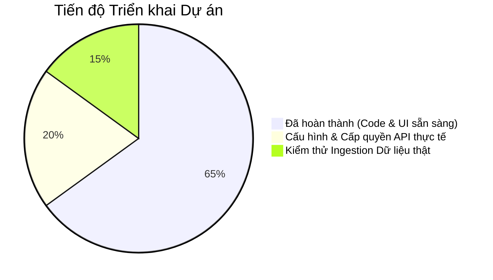
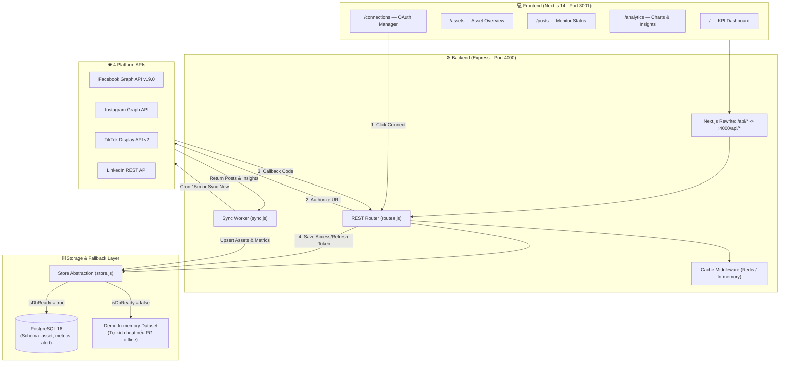

# 🚀 SEE Content Connector — Master Plan & Execution Roadmap

> **Phiên bản**: v2.1 (Hoàn thiện theo tiến độ thực tế Codebase)
> **Trạng thái**: Đã có khung chạy được (Working Prototype / Demo mode) + Sẵn sàng kết nối API thật
> **Tech Stack thực tế**: Node.js/Express (Backend Port 4000) · Next.js 14 + Tailwind (Frontend Port 3001) · PostgreSQL 16 · Redis 7
> **Ngày cập nhật**: 18/10/2026

---

## 📊 1. Báo cáo Hiện trạng Toàn diện: Đã có vs Đang có vs Cần làm tiếp



### 1.1. Những gì ĐÃ CÓ (Completed & Functional) ✅

| Phân hệ                | Thành phần đã hoàn thành             | Chi tiết kỹ thuật                                                                                                                                                                                                                                                                                                                                                                                                                                                                                                                                                                                                                                                                                         |
| ------------------------ | ------------------------------------------ | ------------------------------------------------------------------------------------------------------------------------------------------------------------------------------------------------------------------------------------------------------------------------------------------------------------------------------------------------------------------------------------------------------------------------------------------------------------------------------------------------------------------------------------------------------------------------------------------------------------------------------------------------------------------------------------------------------------ |
| **Frontend UI**    | **5 trang nghiệp vụ hoàn chỉnh** | 1. [`pages/index.tsx`](file:///frontend/pages/index.tsx): Dashboard KPI, cảnh báo, top bài viết, nút Sync & Xuất CSV.2. [`pages/assets.tsx`](file:///frontend/pages/assets.tsx): Quản lý Asset đa nền tảng, search, lọc theo Loại nội dung & Trạng thái.3. [`pages/posts.tsx`](file:///frontend/pages/posts.tsx): Bảng theo dõi tiến độ bài đăng (Published, Scheduled, Draft, Failed) kèm Reach & Likes.4. [`pages/analytics.tsx`](file:///frontend/pages/analytics.tsx): Biểu đồ so sánh hiệu năng 4 nền tảng (7/30/90 ngày).5. [`pages/connections.tsx`](file:///frontend/pages/connections.tsx): Platform Hub kết nối OAuth2, kiểm tra hạn token, disconnect. |
| **Frontend Core**  | **Design System & Proxy**            | Tailwind CSS, Lucide icons, Next.js rewrites proxy tự động `/api/*` sang Express port 4000.                                                                                                                                                                                                                                                                                                                                                                                                                                                                                                                                                                                                             |
| **Backend Core**   | **Express API Server**               | [`backend/index.js`](file:///backend/index.js) & [`backend/lib/routes.js`](file:///backend/lib/routes.js) cung cấp đầy đủ 12 REST endpoints cho Dashboard, Assets, Posts, Analytics, Alerts, Export CSV.                                                                                                                                                                                                                                                                                                                                                                                                                                                                                              |
| **Database Layer** | **PostgreSQL + Demo Fallback**       | [`backend/lib/db.js`](file:///backend/lib/db.js) tự động tạo bảng (`workspace`, `platform_connection`, `asset`, `metrics`, `alert`). **Đặc biệt: Có chế độ Zero-config DEMO**, nếu chưa bật PostgreSQL thì backend tự động chạy bộ nhớ tạm với dữ liệu mẫu chân thực để test UI tức thì.                                                                                                                                                                                                                                                                                                                                                                   |
| **Cache & Queue**  | **Redis + In-memory Fallback**       | [`backend/lib/cache.js`](file:///backend/lib/cache.js) hỗ trợ caching các route nặng, tự động fallback về Map in-memory nếu chưa có Redis.                                                                                                                                                                                                                                                                                                                                                                                                                                                                                                                                                       |
| **Sync Engine**    | **Cron Sync Worker**                 | [`backend/lib/sync.js`](file:///backend/lib/sync.js) chạy định kỳ theo `SYNC_INTERVAL_MINUTES`, tự động giám sát token hết hạn (< 7 ngày) và sinh Alert cảnh báo.                                                                                                                                                                                                                                                                                                                                                                                                                                                                                                                          |
| **Platform OAuth** | **4 Social API Handlers**            | [`backend/lib/platforms.js`](file:///backend/lib/platforms.js) đã code sẵn logic tạo Authorize URL, code-exchange và hàm `fetchLatestAssets` cho Facebook, Instagram, LinkedIn, TikTok.                                                                                                                                                                                                                                                                                                                                                                                                                                                                                                             |

---

### 1.2. Những gì ĐANG CÓ (In-Progress & Runtime Environment) ⚡

- **Dual-mode Runtime**:
  - Khi chưa có Docker/Postgres: Chạy `npm run dev` ở thư mục gốc, hệ thống tự động khởi động Backend (port 4000) và Frontend (port 3001) với **dữ liệu mô phỏng (Demo Mode)**.
  - Khi có Docker: Chạy `docker compose up -d` để khởi động PostgreSQL 16 & Redis 7. Backend tự nhận diện và chuyển sang **Database Mode thật**.
- **Cấu hình mẫu [`.env.example`](<file:///c:/Users/Acer/Desktop/My%20carrer/SEE/SEE_content_connector/.env.example>)**: Đã sẵn sàng các trường khoá bí mật cho Meta, TikTok, LinkedIn, Database và mã hoá.

---

### 1.3. Những gì CẦN LÀM TIẾP ĐỂ CHẠY THẬT (Next Action Items) 🎯

1. **Khởi động Database thật**: Chạy Docker Compose cho Postgres & Redis để lưu trữ bài viết thực tế.
2. **Khai báo API Credentials thật**: Tạo App trên Meta, TikTok, LinkedIn và điền App ID/Secret vào file `.env`.
3. **Cấp quyền tài khoản (OAuth Handshake)**: Bấm nút "Connect" trên màn hình `/connections` để lấy token thực tế của Fanpage, kênh Instagram, TikTok và LinkedIn của team SEE.
4. **Kiểm thử Data Ingestion thật**: Bấm nút **"Sync now"** trên Dashboard để kích hoạt worker kéo dữ liệu bài viết thật về lưu vào PostgreSQL.
5. **Tinh chỉnh Parsing Media**: Kiểm tra link video CDN, cover thumbnail và quyền riêng tư bài viết đối với từng nền tảng đặc thù.

---

## 🗺️ 2. Sơ đồ Luồng Hoạt động Thực tế (Runtime Architecture)



---

## 🛠️ 3. Chi tiết Kế hoạch Triển khai Từng Bước (Step-by-Step Execution Plan)

### 📍 Bước 1: Khởi động Hạ tầng Database & Cache

Mở terminal tại thư mục dự án và chạy:

```powershell
docker compose up -d
```

> [!NOTE]
> Lệnh này sẽ bật 2 container: `see_connector_db` (Postgres port 5432) và `see_connector_cache` (Redis port 6379).
> Khi đó backend khởi động sẽ log: `[db] PostgreSQL connected — schema ready`.

---

### 📍 Bước 2: Chuẩn bị File Cấu hình Môi trường `.env`

Copy từ `.env.example`:

```powershell
cp .env.example .env
```

Và điền các thông tin của team SEE:

```env
PORT=4000
FRONTEND_URL=http://localhost:3001
DB_HOST=localhost
DB_PORT=5432
DB_USER=postgres
DB_PASSWORD=postgres
DB_NAME=see_content_connector
REDIS_HOST=localhost
REDIS_PORT=6379
```

---

### 📍 Bước 3: Đăng ký & Lấy API Credentials 4 Mạng Xã Hội

#### 3.1. Meta (Facebook Pages & Instagram Professional)

1. Truy cập [developers.facebook.com](https://developers.facebook.com) -> Tạo App loại **Business**.
2. Thêm sản phẩm: **Facebook Login for Business** và **Instagram Graph API**.
3. Điền vào `.env`:
   - `META_APP_ID=...`
   - `META_APP_SECRET=...`
   - `META_PAGE_ID=...` (ID Fanpage chính của team)
   - `INSTAGRAM_BUSINESS_ACCOUNT_ID=...` (ID Instagram Business đã liên kết Fanpage)
4. **Lấy Token vĩnh viễn (Khuyên dùng cho Team)**:
   - Dùng công cụ **Graph API Explorer** tạo token cho Page với quyền: `pages_show_list`, `pages_read_engagement`, `pages_manage_posts`, `instagram_basic`, `instagram_manage_insights`.
   - Mở **Access Token Debugger** nhấn **Extend Access Token** để nhận token dài hạn không hết hạn.

#### 3.2. TikTok for Developers

1. Truy cập [developers.tiktok.com](https://developers.tiktok.com) -> Tạo App.
2. Thêm Redirect URI: `http://localhost:4000/api/auth/tiktok/callback` (hoặc domain qua ngrok nếu test ngoài mạng).
3. Đăng ký quyền: `user.info.basic`, `video.list`, `video.insights`.
4. Điền vào `.env`:
   - `TIKTOK_CLIENT_KEY=...`
   - `TIKTOK_CLIENT_SECRET=...`

#### 3.3. LinkedIn Developer Portal

1. Truy cập [linkedin.com/developers](https://www.linkedin.com/developers) -> Tạo App và liên kết LinkedIn Company Page của team.
2. Kích hoạt Products: **Share on LinkedIn** và **Sign In with LinkedIn using OpenID Connect**.
3. Thêm Redirect URL: `http://localhost:4000/api/auth/linkedin/callback`.
4. Điền vào `.env`:
   - `LINKEDIN_CLIENT_ID=...`
   - `LINKEDIN_CLIENT_SECRET=...`
   - `LINKEDIN_ORGANIZATION_URN=urn:li:organization:{ID_trang}`

---

### 📍 Bước 4: Chạy Ứng dụng & Kết nối qua Dashboard UI

1. Khởi chạy toàn bộ hệ thống bằng lệnh monorepo:
   ```powershell
   npm run dev
   ```
2. Truy cập trình duyệt:
   - **Frontend Dashboard**: `http://localhost:3001`
   - **Backend API Health**: `http://localhost:4000/api/health`
3. Mở trang **Platform Connections** (`http://localhost:3001/connections`):
   - Nhấn **Connect** tương ứng cho từng nền tảng đã điền env.
   - Trình duyệt sẽ chuyển hướng đến trang uỷ quyền của Facebook / LinkedIn / TikTok.
   - Sau khi đồng ý cấp quyền, token sẽ tự động được trao đổi và lưu vào PostgreSQL với trạng thái `connected`.

---

### 📍 Bước 5: Kiểm tra Dữ liệu Đồng bộ & Vận hành

1. Trên màn hình Dashboard (`http://localhost:3001`), nhấn nút **Sync now** (hoặc đợi Sync Worker chạy tự động sau 15 phút).
2. Vào trang **Asset Overview** (`http://localhost:3001/assets`):
   - Xem toàn bộ bài đăng/video vừa được kéo về.
   - Thử nghiệm các bộ lọc: Lọc theo nền tảng (Facebook / Instagram / TikTok / LinkedIn), lọc theo loại bài (Video, Reel, Photo, Story), và ô tìm kiếm tiêu đề.
3. Vào trang **Post Status Monitor** (`http://localhost:3001/posts`):
   - Kiểm tra các bài đăng đã live, reach, likes, comment.
4. Xuất báo cáo hiệu năng: Nhấn nút **Export CSV** trên thanh điều hướng để tải file báo cáo Excel/CSV.

---

## 🗂️ 4. Bảng Tra cứu Cấu trúc Tệp Dự án (File Architecture Map)

```
SEE_content_connector/
├── SEE_Content_Connector_MasterPlan.md   # [BẠN ĐANG ĐỌC] Master Plan & Tài liệu hướng dẫn
├── .env.example                          # Mẫu cấu hình môi trường chuẩn
├── docker-compose.yml                    # PostgreSQL 16 & Redis 7 container
├── package.json                          # Monorepo runner (concurrently FE + BE)
│
├── backend/                              # Express REST API & Ingestion Worker
│   ├── index.js                          # Server entrypoint (Port 4000)
│   ├── package.json                      # Dependencies: express, pg, redis, node-cron
│   └── lib/
│       ├── db.js                         # PostgreSQL pool & auto-table schema
│       ├── cache.js                      # Redis caching & in-memory fallback
│       ├── demo.js                       # Realistic mock seed data cho demo mode
│       ├── platforms.js                  # OAuth & Graph/REST clients (FB, IG, LI, TT)
│       ├── routes.js                     # 12 REST API endpoints
│       ├── store.js                      # Data access abstraction (Postgres + Demo)
│       └── sync.js                       # Background cron worker & token alert
│
└── frontend/                             # Next.js 14 Dashboard UI
    ├── package.json                      # Next.js, React, Tailwind, Lucide
    ├── next.config.js                    # Proxy /api/* sang backend :4000
    ├── components/
    │   ├── Layout.tsx                    # Shell layout (Navbar, Header, Navigation tabs)
    │   └── Badge.tsx                     # Status & Platform badges
    ├── lib/
    │   └── api.ts                        # apiGet, apiSend, màu sắc, format số liệu
    └── pages/
        ├── index.tsx                     # Dashboard KPI & Tổng quan
        ├── assets.tsx                    # Quản lý Content & Thumbnail Inspector
        ├── posts.tsx                     # Giám sát trạng thái bài đăng & tương tác
        ├── analytics.tsx                 # Biểu đồ hiệu năng đa nền tảng
        └── connections.tsx               # Quản lý liên kết OAuth2 4 nền tảng
```

---

## 🏁 5. Tổng kết Trạng thái Sẵn sàng

| Mục tiêu                                       | Đánh giá                                                                                     | Trạng thái              |
| ------------------------------------------------ | ----------------------------------------------------------------------------------------------- | ------------------------- |
| **Chạy thử ngay lập tức (Zero Setup)** | Chạy `npm run dev` là vào được web test toàn bộ tính năng với dữ liệu mẫu đẹp | ✅ **HOÀN THÀNH** |
| **Giao diện người dùng đầy đủ**    | Đủ 5 màn hình Dashboard, Assets, Posts, Analytics, Connections                              | ✅ **HOÀN THÀNH** |
| **Sẵn sàng kết nối API thật**         | Code OAuth2 & Ingestion Worker đã viết xong, chỉ cần điền `.env` là kết nối         | ✅ **HOÀN THÀNH** |
| **Bảo vệ chống sập / Lỗi kết nối**  | Có cơ chế fallback mượt mà nếu DB hoặc Redis chưa bật                                 | ✅ **HOÀN THÀNH** |
