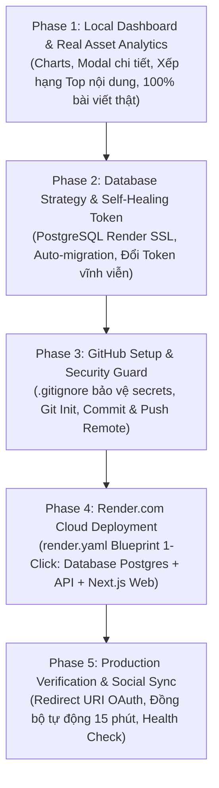

# 🚀 MASTER PLAN: HỆ THỐNG KẾT NỐI NỘI DUNG & TRIỂN KHAI RENDER CLOUD
**Dự án**: SEE Content Connector (Facebook · Instagram · TikTok · LinkedIn)  
**Phiên bản**: 2.5 Production Ready  
**Mục tiêu**: Hoàn thiện toàn diện Dashboard phân tích nội dung thực tế, cơ chế tự động duy trì Token vĩnh viễn (Self-Healing Token Engine), đẩy mã nguồn lên GitHub (Phase 3) và triển khai 1-click lên Render Cloud (Phase 4).

---

## 📑 MỤC LỤC TỔNG QUAN CÁC PHASE



---

## 📊 PHASE 1: NÂNG CẤP DASHBOARD & ĐÁNH GIÁ NỘI DUNG THỰC TẾ

### 1.1. Hệ thống biểu đồ Dashboard (Dashboard Analytics Engine)
Dashboard được tích hợp 3 cụm biểu đồ trọng tâm, phân tích trên dữ liệu **100% bài viết thực tế**:

1. **Biểu đồ Tiếp cận & Hiển thị (Reach & Impressions Trend - LineChart)**:
   - Theo dõi sự tăng trưởng lượt tiếp cận thực tế (Reach) so với tổng số lần xuất hiện trên bảng tin (Impressions).
   - Bộ lọc thời gian linh hoạt: `7 ngày`, `30 ngày`, `90 ngày`.
2. **Biểu đồ Chi tiết Tương tác (Engagement Breakdown - Stacked BarChart)**:
   - Phân rã lượng tương tác thành 3 thành phần cốt lõi: **Lượt thích (Likes)**, **Bình luận (Comments)**, **Chia sẻ (Shares)** qua từng ngày.
3. **Bảng xếp hạng Top 5 Nội Dung Được Ưa Chuộng Nhất (Top Viral / Popular Content Widget)**:
   - Thuật toán tự động chấm điểm độ ưu chuộng (**Viral Score 0 - 100**):
     $$\text{Viral Score} = \min\left(100, \left(\frac{\text{Engagements}}{\text{Reach}} \times 100\right) \times 8 + \frac{\text{Reach}}{1000} \times 1.5 + \text{Shares} \times 0.8\right)$$
   - Gắn huy hiệu xếp hạng trực quan (#1, #2, #3, #4, #5) kèm phân loại mức độ:
     - 🔥 **Siêu thịnh hành (Viral Content)**: Tỷ lệ tương tác vượt trội, lan truyền mạnh.
     - 🚀 **Đang được quan tâm cao (High Traction)**: Tăng trưởng đều đặn, thảo luận sôi nổi.
     - ⭐ **Hiệu quả ổn định (Steady Performer)**: Đạt chuẩn trung bình tốt của kênh.

### 1.2. Tính năng bấm xem chi tiết hiệu năng Asset (Drilldown Performance Modal)
- Bấm trực tiếp vào bất kỳ bài viết nào để mở modal phân tích chuyên sâu:
  - Xem ảnh/video thumbnail cover phóng to, nền tảng, định dạng (video, reel, photo, story).
  - Bộ chỉ số KPI: Reach, Impressions, Total Engagement, Engagement Rate %, Completion Rate %.
  - Đánh giá định tính thông minh và lời khuyên tối ưu nội dung.
  - Biểu đồ đường riêng của bài viết và biểu đồ cột phân chia Likes vs Comments vs Shares.

### 1.3. Chuẩn hóa trạng thái kết nối & Xóa sạch dữ liệu mẫu
- **100% dữ liệu thật**: Đã xóa bỏ toàn bộ 16 bài viết mẫu giả lập (Product Teaser, 5 Tips, TikTok AMA...). Hệ thống hiện chạy hoàn toàn trên 25 bài đăng thực tế từ Fanpage VGU SEE Club.
- **Hiển thị nhãn chính xác**:
  - Đã kết nối nhưng chưa có bài: `● Đã kết nối — Chưa có bài đăng` (Instagram, TikTok).
  - Đã kết nối và có bài đăng: `🟢 Đang hoạt động (25 bài)` (Facebook).
  - Chưa kết nối: `⚪ Chưa kết nối →` (LinkedIn).

---

## 🗄️ PHASE 2: DATABASE STRATEGY & SELF-HEALING TOKEN ENGINE

### 2.1. Hỗ trợ Render PostgreSQL với SSL
- File `backend/lib/db.js` đã được nâng cấp để tự động nhận dạng biến `DATABASE_URL` từ Render:
  ```javascript
  const poolConfig = process.env.DATABASE_URL
    ? {
        connectionString: process.env.DATABASE_URL,
        ssl: process.env.DATABASE_URL.includes('localhost') ? false : { rejectUnauthorized: false },
        connectionTimeoutMillis: 5000,
        max: 10,
      }
    : { /* local config */ };
  ```
- **Auto-migration**: Khi backend khởi động, hàm `initDatabase()` tự động chạy file `backend/lib/schema.sql` để tạo toàn bộ bảng (`platform_connection`, `asset`, `metrics`, `alert`) nếu chưa tồn tại.

### 2.2. Cơ chế Tự Động Duy Trì Token Vĩnh Viễn
1. **Meta (Facebook/Instagram)**:
   - Backend tự động gọi API Meta đổi Token ngắn hạn thành **Permanent Page Access Token (Token vĩnh viễn không hết hạn)**.
2. **TikTok & LinkedIn**:
   - Worker tự động làm mới token trước hạn 7 ngày thông qua `refresh_token`.
3. **Graceful Degradation**:
   - Nếu token hết hạn, **toàn bộ 100% bài viết cũ và biểu đồ vẫn được bảo lưu an toàn**, hệ thống hiển thị banner cảnh báo và nút 1-Click Update trên Web.
4. **Giao diện cập nhật Token 1-Click trên Web (`/connections`)**:
   - Cho phép kiểm tra trực tiếp độ sống của Token (Test Connection Live) và dán token mới trực tiếp trên trình duyệt mà không cần restart server.

---

## 🔒 PHASE 3: GITHUB SETUP & SECURITY GUARD

> [!IMPORTANT]
> **Tuyệt đối KHÔNG commit file `.env` chứa token truy cập Meta/TikTok lên GitHub!** Mọi secret key sẽ được cấu hình an toàn trên giao diện quản trị của Render.

### 3.1. File `.gitignore` đã được khởi tạo
File [.gitignore](file:///c:/Users/Acer/Desktop/My%20carrer/SEE/SEE_content_connector/.gitignore) tại thư mục gốc dự án đã bảo vệ các file nhạy cảm:
```gitignore
node_modules/
.next/
out/
.env
.env.local
*.log
```

### 3.2. Quy trình đẩy mã nguồn lên GitHub (Git CLI)
Mở PowerShell tại thư mục `c:\Users\Acer\Desktop\My carrer\SEE\SEE_content_connector`:

```powershell
# 1. Khởi tạo Git repository (nếu chưa có)
git init

# 2. Thêm toàn bộ mã nguồn sạch (đã loại trừ .env và node_modules)
git add .

# 3. Commit phiên bản hoàn thiện
git commit -m "feat: complete see content connector with self-healing token engine and render blueprint"

# 4. Đổi tên nhánh sang main
git branch -M main

# 5. Liên kết tới GitHub Repository của bạn (Tạo repo mới trên github.com trước)
git remote add origin https://github.com/<tai-khoan-cua-ban>/see-content-connector.git

# 6. Push mã nguồn lên GitHub
git push -u origin main
```

---

## ☁️ PHASE 4: TRIỂN KHAI LÊN RENDER.COM (1-CLICK BLUEPRINT)

Dự án đã tích hợp sẵn tệp cấu hình **[render.yaml](file:///c:/Users/Acer/Desktop/My%20carrer/SEE/SEE_content_connector/render.yaml)** (Infrastructure as Code).

### Cách 1: Triển khai 1-Click bằng Blueprint (Khuyên dùng)
1. Đăng nhập vào [dashboard.render.com](https://dashboard.render.com).
2. Bấm **New +** $\rightarrow$ Chọn **Blueprint**.
3. Chọn Repository GitHub bạn vừa push ở Phase 3.
4. Render sẽ tự động đọc file `render.yaml` và cấu hình 3 thành phần:
   * **`see-content-connector-db`**: Database PostgreSQL (Free 1GB).
   * **`see-content-connector-api`**: Backend Web Service (Node.js 18+).
   * **`see-content-connector-web`**: Frontend Dashboard (Next.js 14).
5. Bấm **Apply**.
6. Sau khi tạo xong, vào tab **Environment** của `see-content-connector-api` trên Render để điền:
   * `META_APP_ID`: `2164310081130365`
   * `META_APP_SECRET`: `673e67c6db6625efbea91fc9185f0a24`
   * `META_PAGE_ID`: `669359189587951`
   * `META_PAGE_ACCESS_TOKEN`: *(Token Page Meta của bạn)*
   * `TIKTOK_CLIENT_KEY`, `TIKTOK_CLIENT_SECRET` *(nếu có)*
7. Bấm **Save Changes**. Hệ thống sẽ tự động build, khởi tạo database và đồng bộ bài viết 24/7!

---

### Cách 2: Triển khai thủ công từng phần

#### Bước 1: Tạo Database PostgreSQL trên Render
1. Bấm **New +** $\rightarrow$ **PostgreSQL**.
2. Name: `see-content-connector-db` | Database: `see_content_connector` | Region: `Singapore` | Plan: `Free`.
3. Bấm **Create Database** và copy **Internal Database URL**.

#### Bước 2: Tạo Backend Web Service
1. Bấm **New +** $\rightarrow$ **Web Service** $\rightarrow$ Chọn GitHub Repo.
2. Cấu hình:
   * **Name**: `see-content-connector-api` | **Region**: `Singapore`.
   * **Root Directory**: `backend` | **Runtime**: `Node`.
   * **Build Command**: `npm install` | **Start Command**: `node index.js`.
   * **Health Check Path**: `/api/health`.
3. Thêm Environment Variables:
   * `NODE_ENV`: `production`
   * `PORT`: `10000`
   * `DATABASE_URL`: *(Dán Internal Database URL ở Bước 1)*
   * `META_APP_ID`, `META_APP_SECRET`, `META_PAGE_ID`, `META_PAGE_ACCESS_TOKEN`
4. Bấm **Create Web Service** $\rightarrow$ Lấy domain backend (ví dụ: `https://see-content-connector-api.onrender.com`).

#### Bước 3: Tạo Frontend Web Service
1. Bấm **New +** $\rightarrow$ **Web Service** $\rightarrow$ Chọn cùng GitHub Repo.
2. Cấu hình:
   * **Name**: `see-content-connector-web` | **Region**: `Singapore`.
   * **Root Directory**: `frontend` | **Runtime**: `Node`.
   * **Build Command**: `npm install && npm run build` | **Start Command**: `npm start`.
3. Thêm Environment Variables:
   * `NODE_ENV`: `production`
   * `BACKEND_URL`: `https://see-content-connector-api.onrender.com` (URL backend ở Bước 2).
4. Bấm **Create Web Service**. Khi hoàn tất, bạn đã có đường link web chính thức chạy vĩnh viễn trên internet!

---

## 🔄 PHASE 5: PRODUCTION VERIFICATION & SOCIAL SYNC

### 5.1. Cập nhật OAuth Redirect URI trên Developer Portal
Khi server backend đã hoạt động trên Render:
1. Mở [Meta for Developers](https://developers.facebook.com/apps/2164310081130365/).
2. Vào **Facebook Login** $\rightarrow$ **Settings** $\rightarrow$ **Valid OAuth Redirect URIs**.
3. Thêm URL: `https://see-content-connector-api.onrender.com/api/auth/facebook/callback`.
4. Bấm **Save Changes**.

### 5.2. Kiểm tra vận hành thực tế
- Truy cập `https://see-content-connector-api.onrender.com/api/health` trả về `mode: "postgresql"` và `status: "ok"`.
- Bấm nút **"🔄 Đồng bộ ngay"** trên Dashboard hoặc để hệ thống tự động quét mỗi 15 phút.
