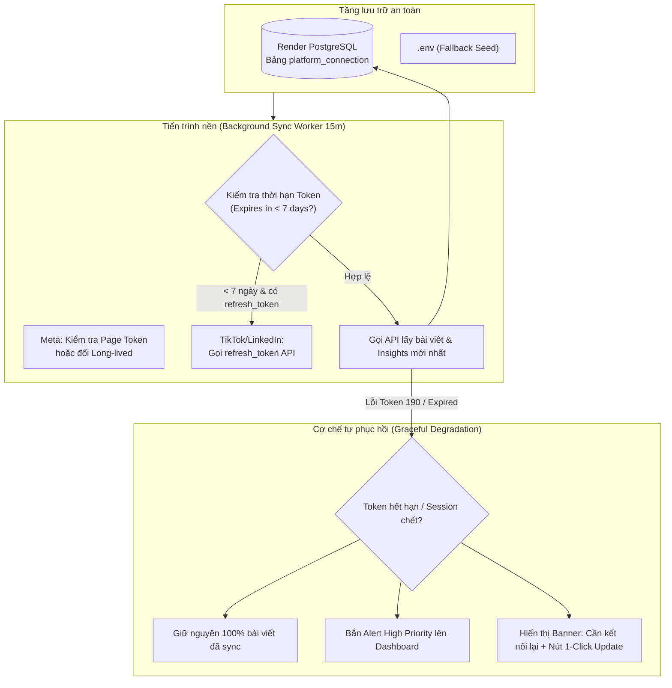

# 🛡️ CHIẾN LƯỢC TỰ ĐỘNG LÀM MỚI TOKEN (AUTO-REFRESH) & CHỐNG GIÁN ĐOẠN ĐỒNG BỘ

**Dự án**: SEE Content Connector  
**Đối tượng**: Facebook Pages, Instagram Professional, TikTok Content API, LinkedIn Social API  
**Mục tiêu**: Xây dựng hệ thống tự động duy trì và làm mới Token (Self-Healing Token Engine), loại bỏ rủi ro ngắt quãng dữ liệu khi token hết hạn, đồng thời cung cấp giao diện cập nhật 1-click thuận tiện.

---

## 1. ĐÁNH GIÁ RỦI RO KỸ THUẬT THEO TỪNG NỀN TẢNG (RISK MATRIX)

Mỗi mạng xã hội có cơ chế vòng đời Token hoàn toàn khác nhau. Dưới đây là bảng đánh giá rủi ro thực tế:

| Nền tảng | Loại Token & Thời hạn | Rủi ro chính | Khả năng tự động hóa 100% |
| :--- | :--- | :--- | :--- |
| **Meta** (Facebook) | Short-lived: 1–2 giờ<br>Long-lived: 60 ngày<br>Page Token: Không hết hạn (hoặc 60 ngày) | Token cấp qua Graph API Explorer mặc định chỉ sống 1–2 giờ. Khi đã hết hạn (Session expired), Meta **từ chối mọi lệnh refresh** và bắt buộc phải xác thực lại. | **Có** (khi kết nối qua OAuth hoặc đổi sang Permanent Page Token ngay từ đầu). |
| **Meta** (Instagram) | Dùng chung Page Token của Facebook hoặc User Token kết nối IG Professional | Hết hạn cùng lúc với token Facebook. Nếu tài khoản Facebook bị đổi mật khẩu hoặc xóa admin Page, token bị hủy lập tức. | **Có** (đồng bộ với Page Token vĩnh viễn). |
| **TikTok** | `access_token`: 24 giờ<br>`refresh_token`: 365 ngày | Token truy cập hết hạn rất nhanh (24h). Nếu cron worker bị tắt quá 365 ngày thì refresh token sẽ chết. | **100% Tự động** thông qua chuẩn OAuth 2.0 `grant_type=refresh_token`. |
| **LinkedIn** | `access_token`: 60 ngày<br>`refresh_token`: 365 ngày | Người dùng thu hồi quyền hoặc tổ chức thay đổi admin trang công ty. | **100% Tự động** làm mới trước khi hết hạn 7 ngày. |

---

## 2. KIẾN TRÚC GIẢI PHÁP TỔNG THỂ (HYBRID SELF-HEALING ARCHITECTURE)



---

## 3. CÁC TRỤ CỘT TRIỂN KHAI CHI TIẾT

### Trụ cột 1: Tự động đổi sang Token Vĩnh viễn / Dài hạn cho Meta (Facebook & Instagram)
1. **Quy trình chuẩn hóa Token Meta**:
   - Khi Backend nhận được Token (qua nút Login Facebook hoặc nhập trong `.env`/UI):
   - Backend tự động gọi endpoint trao đổi của Meta:
     ```http
     GET https://graph.facebook.com/v19.0/oauth/access_token
       ?grant_type=fb_exchange_token
       &client_id={META_APP_ID}
       &client_secret={META_APP_SECRET}
       &fb_exchange_token={SHORT_LIVED_TOKEN}
     ```
   - Lấy tiếp **Permanent Page Access Token** thông qua:
     ```http
     GET https://graph.facebook.com/v19.0/{PAGE_ID}?fields=access_token
     ```
   - Token trả về được lưu vào Database với `token_expires_at = NULL` (Không bao giờ hết hạn), giải quyết vĩnh viễn tình trạng session expired sau 1–2 giờ!

### Trụ cột 2: Auto-Refresh nền tự động cho TikTok & LinkedIn
- Trước khi thực hiện fetch dữ liệu ở mỗi chu kỳ cron (15 phút), Sync Worker kiểm tra:
  ```javascript
  const daysLeft = (new Date(connection.tokenExpiresAt) - Date.now()) / (1000 * 60 * 60 * 24);
  if (daysLeft < 7 && connection.refreshToken) {
    // Tự động gọi API refresh để lấy access_token mới mà không làm phiền người dùng
    const newTokens = await platforms.refreshConnection(connection.platform, connection.refreshToken);
    await store.upsertConnection({ ...newTokens });
  }
  ```

### Trụ cột 3: Chống sập dữ liệu (Graceful Degradation)
- **Nguyên tắc vàng**: Token chết **không bao giờ** làm biến mất bài viết hay biểu đồ đã có!
- Khi API trả về mã lỗi `190` (Invalid Token / Session Expired):
  1. Giữ nguyên 100% danh sách bài viết (`assets`) và số liệu lịch sử trong DB.
  2. Đánh dấu kênh sang trạng thái `action_needed` (Cần kết nối lại).
  3. Tạo Alert ưu tiên cao trên Dashboard:  
     `"⚠️ Kênh Facebook cần cấp lại quyền do phiên đăng nhập hết hạn. Dữ liệu cũ vẫn được bảo lưu an toàn."`
  4. Hiển thị nút **"Cập nhật Token ngay" (1-Click Reconnect)** trực tiếp trên trang chủ.

### Trụ cột 4: Giao diện Quản lý Token 1-Click trên Web (`/connections`)
- Thêm modal cho phép:
  - Nhập/Cập nhật Token mới trực tiếp trên giao diện trình duyệt mà **không cần vào server sửa file `.env` hay restart server**.
  - Kiểm tra tức thì độ hợp lệ của Token (Test Connection Live).
  - Tự động nạp Token từ `.env` vào Database khi hệ thống khởi động lần đầu trên Render.

---

## 4. LỘ TRÌNH THỰC HIỆN (PHASED ACTION PLAN)

### 📌 Bước 1: Backend Token Exchange & Auto-Seeding
- Bổ sung hàm `exchangeForPermanentPageToken(shortLivedToken)` trong [backend/lib/platforms.js](file:///c:/Users/Acer/Desktop/My%20carrer/SEE/SEE_content_connector/backend/lib/platforms.js).
- Bổ sung logic auto-seed từ `.env` vào bảng `platform_connection` khi DB khởi động.

### 📌 Bước 2: Nâng cấp Sync Worker với Auto-Refresh Proactive
- Cập nhật [backend/lib/sync.js](file:///c:/Users/Acer/Desktop/My%20carrer/SEE/SEE_content_connector/backend/lib/sync.js) kiểm tra thời hạn còn lại (< 7 ngày) để chủ động refresh TikTok & LinkedIn.
- Xử lý lỗi `190` của Meta chuyển êm sang chế độ Graceful Degradation.

### 📌 Bước 3: Nâng cấp Frontend UI Kết Nối Nền Tảng
- Cập nhật [frontend/pages/connections.tsx](file:///c:/Users/Acer/Desktop/My%20carrer/SEE/SEE_content_connector/frontend/pages/connections.tsx) với Form "Cập nhật Token nhanh" và nút "Kiểm tra kết nối".
- Thêm Banner thông báo trên Dashboard khi phát hiện có kênh bị hết hạn token để người dùng xử lý ngay bằng 1 click.
